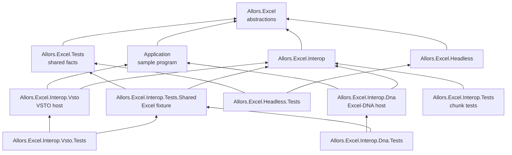

> **Status: Current.** Explanation for maintainers. It describes `main` as read on 2026-10-19.
> [How the virtual workbook works](../virtual-workbook.md) explains the behaviour users rely on;
> this page explains how the code produces it.

## Projects

An arrow points from a project to a project it references; references that follow from these are
omitted. The solution is `src/Excel.sln`.

| Project | Target framework | Role |
| --- | --- | --- |
| `Allors.Excel` | `netstandard2.0` | The abstractions, `Range`, `Style`, the page setup classes, the binding classes, `DefaultValueConverter` and `Utils`. Packaged. |
| `Allors.Excel.Headless` | `netstandard2.0` | The in-memory implementation. Packaged. |
| `Allors.Excel.Interop` | `netstandard2.0` | The implementation over the Office primary interop assemblies. Packaged; needs the `Office` assembly from the GAC or Visual Studio's PIA folder at build time. |
| `Application` | `netstandard2.0` | A sample `IProgram`, `Program`, with `IAlerter` and `IServiceLocator` for its hosts. |
| `Allors.Excel.Interop.Dna` | `net48` | The Excel-DNA host: a `Ribbon` that creates the add-in. |
| `Allors.Excel.Interop.Vsto` | `net48`, classic project with `packages.config` | The VSTO host: `ThisAddIn` and a `Ribbon`. |
| `Allors.Excel.Tests` | `netstandard2.0` | The shared facts, as abstract xunit classes. |
| `Allors.Excel.Headless.Tests` | `net462` | The shared facts against the headless implementation. |
| `Allors.Excel.Interop.Tests.Shared` | `net462` | The Excel fixture and the abstract interop test classes. |
| `Allors.Excel.Interop.Dna.Tests`, `Allors.Excel.Interop.Vsto.Tests` | `net48`, `net462` | The shared facts against Excel. |
| `Allors.Excel.Interop.Tests` | `net462`, `net10.0` | `ChunkTests` for `Cells.Chunks`. |

`src/Directory.Build.props` adds Nerdbank.GitVersioning to every SDK project; the VSTO project
cannot take a package reference and is left out. `stylecop.json` and `.editorconfig` set the code
style; the analysers are warnings, not errors.

## The interop implementation

`AddIn` subscribes to the application's workbook events. `NewWorkbook` and `WorkbookOpen` create a
`Workbook`, create a `Worksheet` for each of its sheets, call the program's `OnNew` for the sheets
and then for the workbook; `WorkbookActivate` creates the `Workbook` when it is unknown and marks
it active; `WorkbookBeforeClose` calls `OnClose` and, unless cancelled, forgets the workbook. With
`ExistentialAttribute` set, each handler first checks the workbook's custom document properties.

`Workbook` keeps a dictionary from Excel's worksheet to its `Worksheet` and subscribes to the
application's `WorkbookNewSheet` and `SheetBeforeDelete` events, filtering on its own workbook by
full name. `AddWorksheet` unsubscribes from `WorkbookNewSheet` while it adds the sheet itself, so
that the sheet is tracked once.

`Worksheet` is the heart of the implementation.

- It keeps `CellByCoordinates`, `RowByIndex` and `ColumnByIndex`, created on demand, and one
  `HashSet` per kind of dirty change: values, formulas, comments, styles, number formats,
  options and rows, plus the queued hyperlinks. A `Cell` setter compares the new value with the
  old one and adds the cell to the matching set through the `Allors.Excel.Interop.IWorksheet`
  methods.
- `Flush` calls `DisableExcel`, which records the calculation mode and the sheet's conditional
  format setting and turns off calculation, screen updating, events, the status bar, print
  communication and conditional formats; then it renders hyperlinks, number formats, values,
  formulas, comments, styles, options and rows, replacing each set with an empty one; then
  `EnableExcel` restores the settings and calculates the sheet when calculation was automatic.
- `Cells.Chunks` groups the dirty cells of one kind: it sorts each row's cells by column and
  collects runs of adjacent cells for which the `combine` predicate holds, then stacks runs that
  start in the same column, have the same width and lie in adjacent rows. Values and formulas
  combine always; styles, number formats and options combine when the setting is equal. Each
  chunk becomes one interop range written with one assignment: a two-dimensional array for values
  and formulas, one setting for the rest. Comments are written per cell, hidden rows per run of
  rows with the same state.
- The chunks of one kind are written with `Parallel.ForEach`. Every COM call goes through
  `WaitAndRetry`, which retries a `COMException` up to ten times with 100 ms pauses and then
  rethrows. A chunk whose range could not be obtained is skipped.
- Excel's `Change` event is handled unless `PreventChangeEvent` is set. For a change smaller than
  a full row, the reported values are converted through each cell's `ValueConverter` and stored
  with `UpdateValue`, and the cells that changed are raised with `CellsChanged` and
  `SheetChanged`. For a change at least as wide as a row, `Reset` re-reads the used range: it
  creates cells for new values, updates existing ones, clears the cells that disappeared, and
  raises `CellsChanged` with everything that changed. `Reset` also runs in the constructor.
- `InsertRows`, `DeleteRows`, `InsertColumns` and `DeleteColumns` set `PreventChangeEvent`, perform
  the change in Excel inside `DisableExcel` and `EnableExcel`, and then move the affected cells to
  their new coordinates, giving each cell its new `Row` or `Column`.

`PropertiesBase`, `BuiltinProperties` and `CustomProperties` wrap Excel's document property
collections through `dynamic`, looking a property up by name.

## The headless implementation

`AddIn`, `Workbook` and `Worksheet` keep lists and dictionaries. The worksheet stores cells by
coordinates, rows and columns by index, named ranges by name and the frozen range; `Flush` does
nothing because every setter stores immediately. `AddWorksheet` places a sheet by the same rules
as the interop workbook. `GetRange` parses A1 references with a small parser whose limits
[API reference](../api.md#iworksheet) states; `GetUsedRange` takes the minimum and maximum of the
existing cells' coordinates. The operations that only Excel can perform are empty or throw
`NotImplementedException`.

## The hosts and the sample program

`Application.Program` is the sample `IProgram`: `OnNew(IWorkbook)` adds a sheet and fills a grid
of numbers with styles, a comment, a list validation through `Options`, a date column and an
`AutoFit`; `OnHandle` handles the ids in `Actions`, hiding rows for `hide`. The Excel-DNA host
creates the add-in in `GetCustomUI` and calls `OnStart` in `OnLoad`; the VSTO host creates it at
startup on a thread-pool thread, calls `OnStart`, and calls `OnStop` at shutdown.
[Build an Excel add-in](../build-an-add-in.md) quotes both.

## Tests

`Allors.Excel.Tests` holds the facts once, in the abstract classes `WorkbookTests` and
`WorksheetTests`, which derive from `ExcelTest` and call `NewAddIn()` and `AddWorkbook()` on the
concrete class. `TestProgram` is the program every suite uses: it adds a second sheet to each new
workbook, fills `A1` and `O50` of that sheet so that `GetUsedRange` finds fifty rows and fifteen
columns, and renames every new sheet to the next number, so that the tests find sheets `1` and `2`.

The suites, each with `[assembly: CollectionBehavior(DisableTestParallelization = true)]`:

- `Allors.Excel.Headless.Tests` creates a headless `AddIn` with a mocked `IRibbon` and closes the
  workbooks afterwards.
- `Allors.Excel.Interop.Tests.Shared` provides `InteropExcelFixture`: one visible Excel instance
  per test, created in the test class constructor so that it starts after the base constructor.
  It records Excel's process id while Excel is healthy, disconnects the repository's own VSTO
  add-in in that instance so that an installed copy cannot interfere, and opens a copy of
  `data/blank.xlsx` for each workbook, because `Workbooks.Add()` would take the sheet count from
  the machine's default template. Disposal closes the workbooks and quits; a `COMException` during
  teardown, which Excel has produced on CI, makes the fixture kill the process instead.
- `Allors.Excel.Interop.Dna.Tests` and `Allors.Excel.Interop.Vsto.Tests` derive from the shared
  interop classes. They reference the host projects so that both hosts build; neither host is
  loaded into the Excel the tests drive.
- `Allors.Excel.Interop.Tests` holds `ChunkTests`, eleven facts about `Cells.Chunks` on cells
  without a worksheet, and is the only project that targets `net10.0` as well.

[Build and test](build-and-test.md#test-passes) lists the passes, their results and what the
Excel passes need from the machine.

## Known defects

Observed on 2026-10-19 in the source and in the local run described in
[Build and test](build-and-test.md#local-run); none is fixed by the documentation change.

- `Style.TextColor` is never written to Excel: `RenderStyle` writes the background colour only.
- The VSTO host's `Ribbon.xml` names the callbacks `GetDoSomethingLabel` and `OnClick`, and its
  `Ribbon` class implements neither, so its buttons cannot work.
- The headless `Worksheet.CustomProperties` is never assigned and is `null`.
- `IWorkbook.TryDeleteCustomXmlById` catches `COMException` only; an unknown id makes
  `SelectByID` return `null`, and the call throws `NullReferenceException`.
- `IWorksheet.HideInputMessage(cell, clearInputMessage: true)` clears the validation's
  `ErrorMessage` and `ErrorTitle` instead of its input message and title.
- `SetNamedRange` on the workbook and on the worksheet swallows every exception, so a name that
  Excel refused is silently absent; in the local run that turned COM errors into failed
  assertions on `GetNamedRanges` and into `Name not found for namedRange` from `GetRectangle`.
- `InteropExcelFixture` leaks the Excel instance when its constructor throws after Excel started,
  because `Dispose` never runs; the local run left one instance open.
- The package metadata's project URL points at the Documents repository; see
  [Packages and versions](../packages.md#packages).
- `task restore` runs `dotnet tool restore`, but the repository has no tool manifest, so the step
  reports `No tools were restored`.
- `Allors.Excel.Interop.Constants` declares five identifiers that nothing uses.
