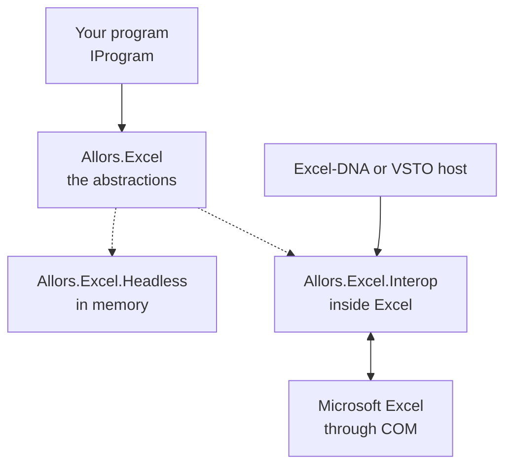

> **Status: Current.** Explanation for users. It describes `Allors.Excel`, `Allors.Excel.Headless`
> and `Allors.Excel.Interop` as they are on `main`, checked against the tests named at the end.

An Excel add-in that talks to Excel cell by cell is slow and hard to test: every property is a
COM call, and nothing runs without Excel. Allors Excel puts a virtual workbook between the add-in
and Excel. The add-in reads and writes ordinary objects; the library writes the changes to Excel
in blocks and reports the changes a user makes. This page explains the pieces and what each one
guarantees.

## The program, the abstractions and two implementations

A solid arrow points from code to code it uses; a dotted arrow points from the abstractions to
an implementation of them.

`Allors.Excel` declares the abstractions. `IAddIn` holds the workbooks and the ribbon; an
`IWorkbook` holds worksheets, named ranges, document properties and custom XML parts; an
`IWorksheet` holds cells, rows and columns and the operations on a sheet; an `ICell` has a value,
a formula, a comment, a style, a number format and list options. Rows and columns are zero-based:
`sheet[0, 0]` is `A1`. A cell, row or column exists as soon as it is asked for; the indexer creates
it.

The package has two implementations of these abstractions.

- **Headless** keeps everything in memory. It is for tests and for tools that run without Excel.
  It stores what it is given and calculates nothing: a formula stays the text you set, and the
  operations that only make sense in Excel do nothing or throw.
  [API reference](api.md#headless-and-interop-differences) lists them.
- **Interop** runs inside Excel. A host, written with Excel-DNA or VSTO, creates
  `Allors.Excel.Interop.AddIn` with Excel's `Application` object; from then on the add-in follows
  Excel's events and writes through the primary interop assemblies.

Your program sees the same interfaces in both cases. The repository's own tests are written once,
against the interfaces, and run against the headless workbook and against a real Excel; see
[Architecture](internals/architecture.md#tests).

## The lifecycle of a program

Your `IProgram` receives callbacks. The library calls some of them; the others exist for the
host, which calls them from its ribbon or its startup code. In the interop implementation:

| Callback | Called by |
| --- | --- |
| `OnStart(IAddIn)` | The host, once it has created the add-in. The repository's Excel-DNA host calls it when the ribbon loads; its VSTO host calls it at startup. |
| `OnNew(IWorkbook)` | The add-in, when Excel raises `NewWorkbook` or `WorkbookOpen` for a workbook it tracks, after `OnNew(IWorksheet)` for each of the workbook's sheets. |
| `OnNew(IWorksheet)` | The add-in, for each sheet of a new or opened workbook, for a sheet added with `AddWorksheet`, and when Excel raises `WorkbookNewSheet` because the user added a sheet. |
| `OnClose(IWorkbook, ref bool cancel)` | The add-in, when Excel raises `WorkbookBeforeClose` for a tracked workbook. Set `cancel` to keep the workbook open; otherwise the add-in stops tracking it. |
| `OnBeforeDelete(IWorksheet)` | The add-in, when Excel raises `BeforeDelete` for a sheet that the user added after the add-in started tracking the workbook. Sheets that existed earlier do not report their deletion. |
| `OnStop()` | The host, at shutdown; the VSTO host does, the Excel-DNA host does not. |
| `OnHandle(string handle, params object[] argument)`, `OnLogin()`, `OnLogout()`, `IsEnabled(string controlId, string controlTag)` | Nothing in the library. They are the hooks for a host's ribbon: a button's `onAction` callback calls `OnHandle` with the control's id, and a `getEnabled` callback calls `IsEnabled`. The repository's hosts do not wire them; [Build an Excel add-in](build-an-add-in.md#wire-the-ribbon) shows how. |

The headless `AddIn` has no host. Its constructor creates one workbook with one worksheet and
calls `OnNew(IWorksheet)`, `OnNew(IWorkbook)` and then `OnStart(IAddIn)`, in that order, so
`OnNew` runs before `OnStart`. Every `AddWorkbook()` creates another workbook the same way.

The callbacks return `Task`, but the library does not await them: it calls them and continues.
Work that must be finished before the add-in continues, such as filling a new workbook, should
therefore complete synchronously, as the examples in this documentation do. An exception thrown
after the first `await` of a callback is not observed by the library.

The interop add-in tracks a workbook from the moment Excel reports it as new or opened, or when
it is activated. Workbooks that were already open when the add-in started appear in `Workbooks`
once the user activates them, without an `OnNew`. With `ExistentialAttribute` set to the name of a
custom document property, the add-in tracks only workbooks that have that property, so that an
add-in acts on its own workbooks and leaves others alone.

## Writing: dirty cells and Flush

Setting a cell's `Value`, `Formula`, `Comment`, `Style`, `NumberFormat` or `Options`, or a row's
`Hidden`, changes the object and marks it dirty. Nothing reaches Excel until you call
`IWorksheet.Flush()`. A value is dirty when it is set for the first time, even to `null`, and
afterwards when it changes; the other properties are dirty when they change.

`Flush` writes every dirty change of the worksheet, in this order: hyperlinks, number formats,
values, formulas, comments, styles, options and hidden rows. Before writing it switches Excel to
manual calculation and turns off screen updating, events, the status bar, print communication and
the calculation of conditional formats; afterwards it restores them and recalculates the sheet
when calculation was automatic. Because events are off, the changes the library writes do not come
back as change events.

Each kind of change is written in **chunks**: rectangular blocks of adjacent dirty cells. Values
and formulas go to Excel as two-dimensional arrays, one chunk per block, and a style, a number
format or an option range covers one block of cells that share the same setting. Comments are
written cell by cell, and hidden rows in runs of rows with the same state. The chunks are written
in parallel; a COM call that Excel rejects because it is busy is retried up to ten times, 100 ms
apart.

A cell's `Style` writes the cell's background colour. The `TextColor` of a `Style` is kept on the
cell but not written to Excel; observed in the source on 2026-10-19 and not covered by a test.

`AddHyperLink(text, cell)` queues a hyperlink without an address, whose displayed text is `text`.
When the user clicks it, Excel raises `FollowHyperlink`, the worksheet raises `HyperlinkClicked`
with the text in `DisplayName`, and your program decides what to do. That turns a cell into a
button.

In the headless implementation every property is stored immediately and `Flush` does nothing.

## Reading: what Excel reports

When the interop worksheet is created, it reads Excel's used range once and creates a cell for
every value in it. From then on it listens to Excel's `Change` event. For each changed cell it
converts the reported value with the cell's `IValueConverter` and stores it; if the stored value
changed, the cell is collected. The worksheet then raises `CellsChanged` and `SheetChanged`, both
with the same `CellChangedEvent` listing the collected cells. A change that spans at least as many
cells as a row has columns, which is what inserting or deleting rows produces, makes the worksheet
re-read the used range instead: cells that disappeared are cleared and reported as changed too.

`DefaultValueConverter` keeps the type a cell already had. Excel reports numbers as `double`; for
a cell whose value was a `decimal` or an `int`, the converter converts the number back to that
type, clamping it to the type's range, and for a `DateTime` it converts the OLE automation date.
For a cell whose value was a `string`, `null` becomes the empty string and any other value is
converted to text. Otherwise the reported value is stored as it is. Set `ValueConverter` on a cell
to decide differently.

Rows and columns that the program inserts or deletes through `InsertRows`, `DeleteRows`,
`InsertColumns` and `DeleteColumns` are changed in Excel with the change event suppressed, and the
worksheet moves its own cells to their new coordinates, so a cell object keeps following its
content. [API reference](api.md#iworksheet) states which rows and columns each operation affects.

The headless worksheet never raises change events: nothing changes a cell except your program.

## Where the facts live

The shared tests in `src/Allors.Excel.Tests` run against both implementations, through
`Allors.Excel.Headless.Tests` and through the interop suites, which drive a real Excel; see
[Build and test](internals/build-and-test.md#test-passes).

- `WorksheetTests.InsertRows`, `DeleteRows`, `InsertColumn`, `InsertColumns`, `DeleteColumn` and
  `DeleteColumns`: cells follow their content when rows and columns move.
- `WorksheetTests.AddWorksheetsByIndex`, `AddWorksheetsBeforeAndAfter` and the `NewSheet…Index`
  tests: where `AddWorksheet` places a sheet and which index it gets.
- `WorksheetTests.GetRange`, `GetUsedRange` and `GetRectangle`: zero-based ranges from A1 names,
  the used range and the rectangle of a named range.
- `WorksheetTests.FreezePanes`, the `SaveAsPdf…` and `SaveAsXps…` tests, `SetPrintArea`,
  `SaveAsPdfWithHeader` and `PageSetupOrientationDefaultsToPortrait`: panes, export and page setup.
- `WorkbookTests.BuiltinProperties`, the `Custom…Properties` tests, `SetCustomXmlParts`,
  `DeleteCustomXmlParts` and the named-range tests: document properties, custom XML parts and
  workbook- and worksheet-scoped names.
- `ChunkTests` in `src/Allors.Excel.Interop.Tests`: how dirty cells are grouped into chunks.

The change events, the value converter and `Flush` itself are not covered by the shared tests; the
description above follows `src/Allors.Excel.Interop/Worksheet.cs` and `Cell.cs`.
